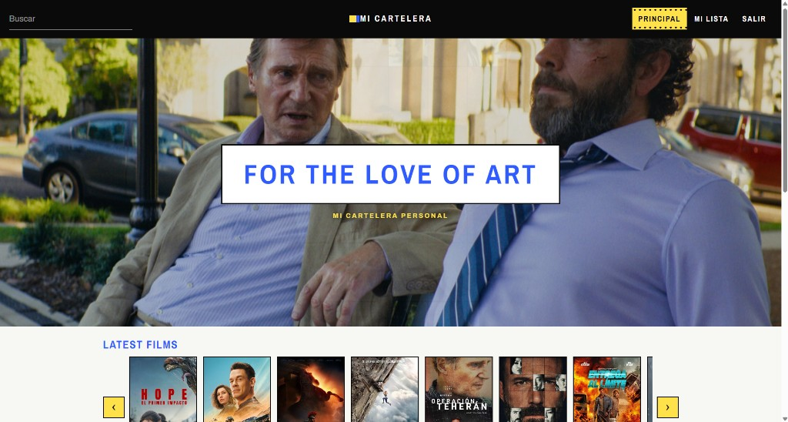
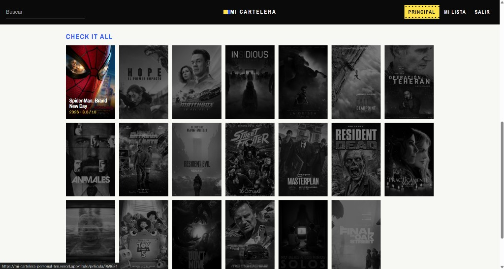
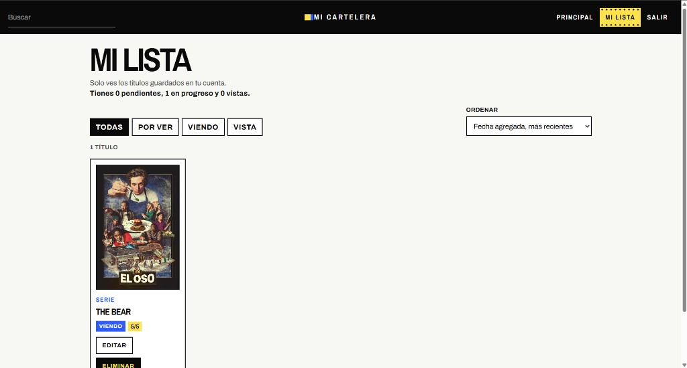
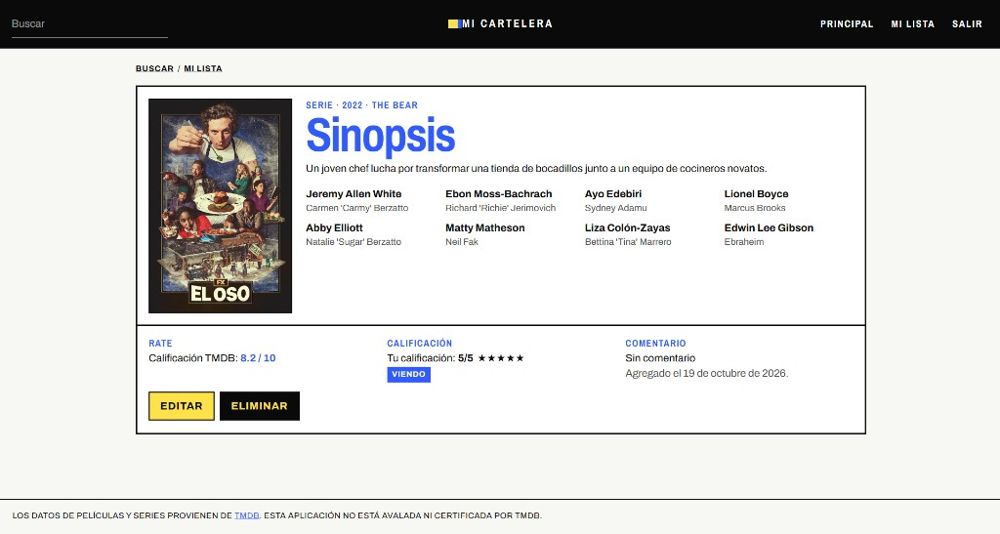
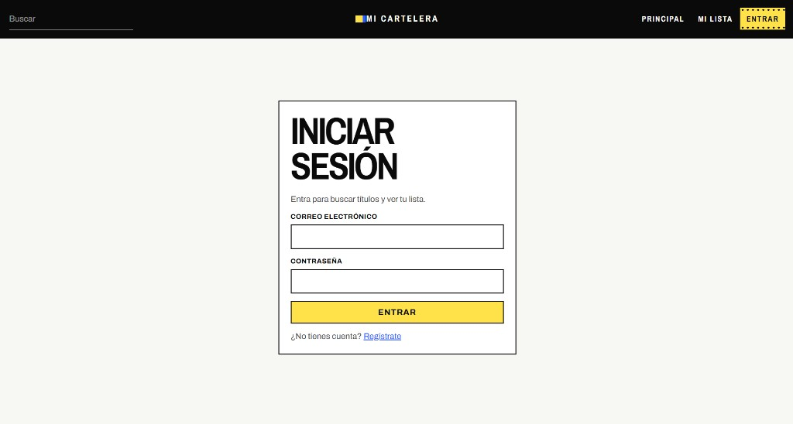
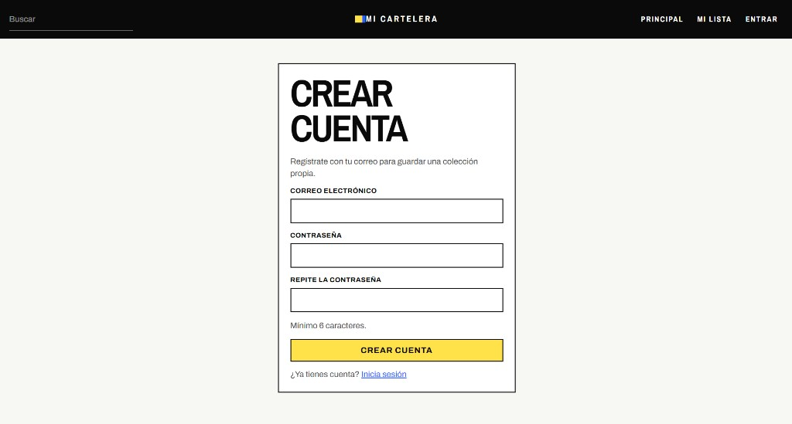

# Mi Cartelera Personal

Link Vercel: mi-cartelera-personal-ten.vercel.app
Aplicación web para buscar películas y series en TMDB y guardar una colección personal. Cada cuenta ve solo sus títulos: estado (Por ver, Viendo o Vista), calificación del 1 al 5 y un comentario opcional.

La portada muestra un fondo de fotogramas, un carrusel de estrenos y el catálogo. La ficha separa la sinopsis y la calificación de TMDB de los datos que guarda el usuario en Supabase. El acceso usa Supabase Auth y PostgreSQL con Row Level Security.

## Instalación

Hace falta Node.js 20 o superior, un proyecto de Supabase y una clave de lectura de TMDB.

### 1. Instalar dependencias

```bash
npm install
```

### 2. Variables de entorno

Copia el ejemplo y completa los valores:

```bash
copy .env.example .env
```

```env
VITE_SUPABASE_URL=https://tu-proyecto.supabase.co
VITE_SUPABASE_ANON_KEY=tu_clave_publica_anon_o_publishable
VITE_TMDB_API_KEY=tu_api_key_de_tmdb
```

| Variable | Dónde obtenerla |
| --- | --- |
| `VITE_SUPABASE_URL` | Supabase → Project Settings → API → Project URL |
| `VITE_SUPABASE_ANON_KEY` | La clave pública **anon** o **publishable** (`sb_publishable_...`). No uses `service_role` ni `sb_secret_` |
| `VITE_TMDB_API_KEY` | TMDB → Settings → API. Sirve la API Key v3 o el Read Access Token |

`.env` no se sube al repositorio. Las variables `VITE_*` quedan visibles en el navegador, así que solo deben llevar claves públicas de lectura.

Opcionales, con estos valores por defecto si no las defines:

```env
VITE_TMDB_BASE_URL=https://api.themoviedb.org/3
VITE_TMDB_IMAGE_BASE=https://image.tmdb.org/t/p
```

### 3. Arrancar

```bash
npm run dev
```

Abre la URL que muestra Vite, normalmente `http://localhost:5173`. Reinicia el comando si cambias `.env`.

## Capturas

### Principal

El hero, Latest films y el inicio del catálogo.



### Catálogo

Todas las películas. Al pasar el cursor, el póster recupera el color y muestra título, año y nota de TMDB.



### Mi lista

Filtros por estado, orden y el resumen de pendientes, en progreso y vistas.



### Detalle

Sinopsis, elenco y la banda de rate, calificación personal y comentario.



### Iniciar sesión



### Crear cuenta



Los datos de películas y series provienen de TMDB. Esta aplicación no está avalada ni certificada por TMDB.
